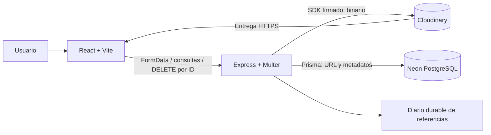

# Cloud Media Vault

Biblioteca multimedia del taller de Desarrollo de Experiencias Multimedia para la Web.
**Ruta B:** React + Vite, Express + Multer, Cloudinary y Neon/PostgreSQL con Prisma.
Sube imágenes, videos y PDF, busca por título, filtra por categoría y elimina desde
una interfaz responsive en español. El máximo es **10 MB (10 MiB)** por archivo.

El binario se guarda exclusivamente en Cloudinary. PostgreSQL conserva URL HTTPS,
referencia cloud y metadatos. No hay login: el autor es un dato del formulario,
no una identidad verificada. Este proyecto es independiente de BuscaCampus.

## Demostración y entrega

- **Repositorio:** [juanffff-hub/cloud-media-vault](https://github.com/juanffff-hub/cloud-media-vault).
- **Video:** [ver o descargar la demostración completa (MP4)](Video%20Demostracion%20en%20VIVO/Taller%20Media%20Cloud%20Voult%20Video%20Funcionamiento.mp4).
- **Revisión final:** [requisitos comprobados y resultados de pruebas](docs/revision-final.md).

La grabación de pantalla dura aproximadamente **5 minutos y 7 segundos**, está en
1080p y pesa **19,5 MB**. Muestra rechazos de archivos inválidos, subida de imagen,
video y PDF, sus recursos en Cloudinary y registros en Neon, y eliminación desde
la web con comprobación en ambos servicios. Al final se muestran más cargas,
búsqueda, filtros y paginación. No contiene narración; la evidencia es visual.
Si GitHub no reproduce el archivo, descárgalo para verlo.

| Momento aproximado | Evidencia |
| --- | --- |
| 00:00–00:50 | Validaciones de tamaño, formato, contenido y selección |
| 00:50–01:55 | Subida desde React de imagen, video y PDF |
| 01:55–02:35 | Registros en Neon y recursos en Cloudinary |
| 02:35–03:50 | Borrado desde React, búsqueda por publicId sin resultados en Cloudinary y consulta vacía en Neon |
| 03:50–05:07 | Nuevas cargas y uso de la biblioteca, búsqueda, filtros y paginación |

El MP4 del repositorio es evidencia de entrega. El límite de 10 MB se aplica a
los archivos que recibe la aplicación, no al tamaño de esta grabación.

## Equipo

| Parte | Integrante | Cuenta / rama | Responsabilidad |
| --- | --- | --- | --- |
| 1 | Juan Felipe Fajardo | juanffff-hub / fajardo-cloud-vault | Arquitectura cloud y base de datos |
| 2 | David Neira Conde | DavidN09 / neira-cloud-vault | Ingesta y subida cloud |
| 3 | Juan Sebastian Gomez | sebasgomezmunoz3-ship-it / gomez-cloud-vault | Persistencia CRUD y sincronización |
| 4 | Juan David Ortiz | Juanortizd17 / juanda-cloud-vault | Formulario, galería y QA; fusiona roles 4 y 5 |

Cada parte conserva seis commits técnicos y un PR con merge commit: 24 commits de
implementación y cuatro integraciones, además del commit inicial del repositorio.
La entrega añade un commit de documentación y video con la última cuenta,
`Juanortizd17`; este cierre no modifica los 24 commits técnicos de las cuatro partes.
Los titulares deben revisar y asumir su contribución; cambiar la cuenta Git no
sustituye la participación real. [Consigna y rúbrica](docs/requisitos.md).

## Arquitectura



La API solo confirma una subida con **201 después de cloud y DB**. Si DB rechaza
la escritura, intenta compensar el recurso cloud. Los resultados inciertos quedan
registrados para reconciliación. DELETE usa publicId y resourceType de la DB,
confirma el borrado cloud e invalida caché antes de retirar metadatos. Los estados
parciales quedan ocultos y admiten reintento. [Decisiones completas](docs/arquitectura.md).

```text
client/          React + Vite: formulario, vistas previas y galería
server/          Express: validación, servicios, adaptadores y pruebas
server/prisma/   Modelo de metadatos y migraciones PostgreSQL
docs/            API, arquitectura, pruebas, recuperación e informes
Video Demostracion en VIVO/   Grabación de la entrega
```

## Instalar y configurar

Requisitos: **Node.js 24 LTS**, **npm 11**, Git y cuentas propias de Neon y Cloudinary.
Desde la raíz del repositorio:

```sh
npm ci
```

Copia las plantillas solo si todavía no existen los archivos locales:

```powershell
if (!(Test-Path server/.env)) { Copy-Item server/.env.example server/.env }
if (!(Test-Path server/.env.test)) { Copy-Item server/.env.test.example server/.env.test }
if (!(Test-Path client/.env)) { Copy-Item client/.env.example client/.env }
git check-ignore server/.env server/.env.test client/.env
```

Sigue la [guía local paso a paso](docs/configuracion-local.md). En `server/.env`,
configura la base exclusiva `cloud_media_vault`: DATABASE_URL con pooling y DIRECT_URL
sin pooling; conserva TLS. Configura las credenciales Cloudinary solo en ese archivo.
Mantén el prefijo `cloud-media-vault` y habilita la entrega de PDF en Security.
La base separada `cloud_media_vault_test` se configura en `server/.env.test`.

`client/.env` solo contiene VITE_API_BASE_URL y el límite público de tamaño.
Nunca uses prefijo VITE_ para credenciales. `.env`, dependencias, builds, diarios,
capturas de pruebas y archivos cargados están ignorados por Git.

Aplica migraciones y comprueba ambos servicios:

```sh
npm run db:migrate -w server
npm run db:generate -w server
npm run db:check -w server
npm run cloud:check -w server
```

## Ejecutar

```sh
npm run dev
```

Abre **http://127.0.0.1:5173**. API: **http://127.0.0.1:3001/api**.
CLIENT_ORIGIN debe coincidir exactamente con el origen del navegador; cambiar
127.0.0.1 por localhost requiere actualizar configuración. Detén con Ctrl+C.

1. Escribe título y autor. Selecciona o arrastra un archivo.
2. Revisa la vista previa y pulsa **Subir archivo**. 100% de envío aún requiere
   esperar la confirmación de guardado; después aparece en la biblioteca.
3. Busca por título, elige categoría y recorre las páginas. Abre imagen/PDF o reproduce video.
4. Pulsa el icono de papelera y confirma. Si hay un fallo parcial, usa el aviso de reintento.

Formatos: JPEG, PNG, WebP, MP4, WebM y PDF. Cliente y servidor validan tamaño y
formato; el servidor también inspecciona firma y estructura. La selección es de un
archivo a la vez. Los binarios no se conservan en disco del servidor ni en PostgreSQL.

```sh
npm run build
# Backend compilado:
npm run start -w server
# Vista previa local del cliente, en otra terminal y con el servidor dev detenido:
npm run preview -w client -- --port 5173 --strictPort
```

La vista previa de Vite sirve para comprobar el build local. Un despliegue debe
conservar `server/var/` en almacenamiento persistente y configurar sus orígenes/URLs.

## Pruebas

```sh
npm run check
npm run test:db -w server
npx playwright install chromium
npm run test:e2e -w client
```

`check` verifica tipos, 39 pruebas del cliente, 144 del servidor y ambos builds.
`test:db` aplica la migración en Neon de prueba y verifica modelo, CRUD y fallos entre
proveedores. Las seis pruebas de navegador cubren escritorio y móvil con API simulada;
usan Vite temporal en el puerto 5174. La CI añade PostgreSQL 17 efímero y Chromium.

Pruebas reales: se necesita FFmpeg en PATH (o FFMPEG_PATH apuntando al ejecutable).
Para la prueba de interfaz, deja `npm run dev` activo y ejecuta en otra terminal:

```sh
npm run test:e2e:live -w client
# Alternativa HTTP con base de prueba, sin interfaz:
npm run test:assets:live -w server
# Los seis formatos mediante el adaptador:
npm run test:cloud:live -w server
```

La prueba real de navegador genera PNG, MP4 y PDF propios, los sube desde React,
verifica Cloudinary y Neon, revisa entrega HTTPS y los elimina desde React. Usa
`cloud_media_vault`, títulos únicos y el prefijo exclusivo del proyecto; retira sus
propios archivos y registros. Guarda evidencia local en `tmp/browser-live/`, sin
credenciales. [Resultados finales](docs/informe-parte-4.md) y [reproducción de pruebas](docs/pruebas-parte-4.md).

## API y recuperación

| Método | Ruta | Resultado |
| --- | --- | --- |
| POST | /api/archivos | 201 con registro persistido |
| GET | /api/archivos | 200 con data y meta; buscar, categoria, pagina, limite |
| DELETE | /api/archivos/:id | 204 vacío tras confirmar ambos servicios |
| GET | /api/health | 200 si PostgreSQL responde |

[Contrato REST, validación y errores](docs/api.md). Errores JSON seguros, sin SQL ni secretos.
CORS no es autenticación y `health` comprueba DB, no disponibilidad de Cloudinary.
La invalidación CDN puede tardar; el borrado se verifica con la API de Cloudinary.

```sh
# Solo inspección, sin modificar recursos:
npm run assets:recover -w server
npm run uploads:reconcile -w server
```

Para ejecutar una recuperación concreta, sigue [estados y recuperación](docs/recuperacion.md).
No borres el diario para silenciar un error ni reenvíes una subida incierta sin revisar
la biblioteca. No hay reintento automático de POST ni transacción literal entre proveedores.

## Entrega

- [Video de demostración entregado](Video%20Demostracion%20en%20VIVO/Taller%20Media%20Cloud%20Voult%20Video%20Funcionamiento.mp4) y [revisión final](docs/revision-final.md).
- [Pasos para repetir la demo, consulta general de Neon y guion de hasta ocho minutos](docs/demo.md).
- [Modelo y migraciones](docs/modelo-datos.md), [salud](docs/salud.md), [Cloudinary](docs/cloudinary.md), [ingesta](docs/ingesta.md).
- Informes históricos: [Parte 1](docs/informe-parte-1.md), [Parte 2](docs/informe-parte-2.md), [Parte 3](docs/informe-parte-3.md), [Parte 4](docs/informe-parte-4.md).
- PR: [arquitectura #1](https://github.com/juanffff-hub/cloud-media-vault/pull/1), [ingesta #2](https://github.com/juanffff-hub/cloud-media-vault/pull/2), [CRUD #3](https://github.com/juanffff-hub/cloud-media-vault/pull/3), [interfaz #4](https://github.com/juanffff-hub/cloud-media-vault/pull/4).
