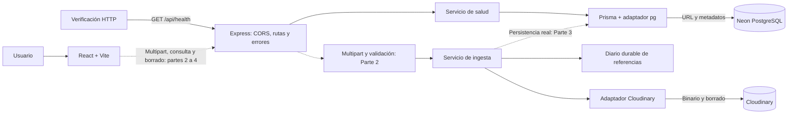

# Arquitectura de Cloud Media Vault

Ruta B, aplicación independiente. Node.js 24, npm workspaces, TypeScript, React/Vite,
Express 5, Prisma 7.10.1 con adaptador PostgreSQL y Cloudinary SDK solo en backend.

Las conexiones discontinuas representan flujos aún no registrados en la API.
La Parte 1 provee base ejecutable, configuración, modelo/migración, salud y adaptadores.
La Parte 2 prepara y prueba la ingesta con un contrato de persistencia inyectable.
No hay un POST público que confirme éxito sin persistencia: se montará en Parte 3.

## Decisiones

1. **Dos almacenes, funciones separadas.** Cloudinary conserva binarios y PostgreSQL
   conserva referencias y metadatos. La DB no tiene columnas binarias. El backend
   recibe los archivos; React nunca usa credenciales ni subidas unsigned.
2. **Configuración validada.** `.env` local ignorado, plantillas sin credenciales y
   mensajes que identifican campos inválidos sin mostrar valores. Origen CORS exacto.
3. **Conexiones Prisma 7.** Config CLI con URL directa; ejecución con pool de cinco
   conexiones y tiempos máximos. Una instancia Prisma por proceso y cierre ordenado.
4. **Pruebas aisladas.** Base `cloud_media_vault_test`, distinta de `cloud_media_vault`.
   Scripts rechazan otro destino, no resetean tablas y limpian solo registros propios.
5. **Estado recuperable.** El esquema prepara ACTIVO, ELIMINANDO, ERROR_BORRADO y
   NUBE_ELIMINADA. La Parte 3 implementará la transición y recuperación persistente;
   el listado excluirá todo estado distinto de ACTIVO. No existe transacción compartida
   entre Cloudinary y PostgreSQL.
6. **Subidas inciertas.** Antes de transferir se guarda una referencia en un diario con
   `fsync`. La ingesta compensa fallos y conserva operaciones pendientes; un timeout
   no prueba que el proveedor no creó un recurso. Parte 3 conectará su reconciliación
   con PostgreSQL. El diario requiere almacenamiento persistente al desplegar.
7. **PDF como image.** Se guarda el resourceType devuelto por Cloudinary y se verifica
   la entrega de PDF en su configuración Security. Borrado con invalidación de CDN.
8. **Sin autenticación añadida.** `subidoPor` no acredita identidad. CORS no impide
   solicitudes desde herramientas ajenas al navegador. El alcance es la aplicación del taller.

## Límites del estado actual

- Multipart, validación y transferencia están implementados y probados. Faltan
  conectar la persistencia real al POST, el CRUD y la galería.
- `health` verifica DB; no hace ping a Cloudinary.
- Multer admite dos cargas simultáneas, limita cada archivo a 10 MiB y acota campos,
  partes y recepción. La inspección usa un worker con plazo y memoria acotados.
- Las pruebas con dobles no sustituyen migración/conexión reales a Neon ni la demo final.

Detalle: [modelo](modelo-datos.md), [salud](salud.md), [Cloudinary](cloudinary.md),
[configuración](configuracion-local.md), [ingesta](ingesta.md),
[verificación de arquitectura](pruebas-parte-1.md), [verificación de subida](pruebas-parte-2.md).
